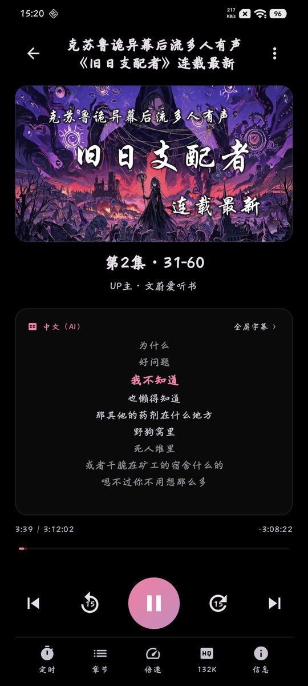
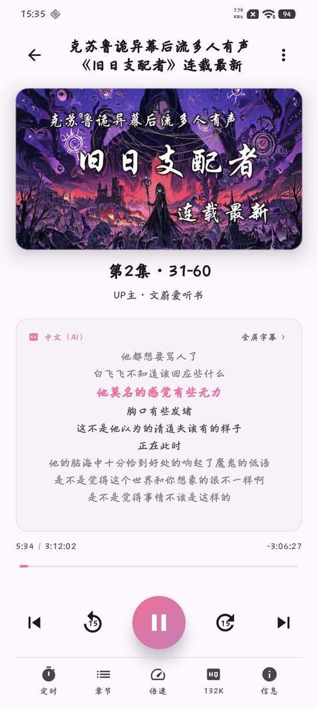
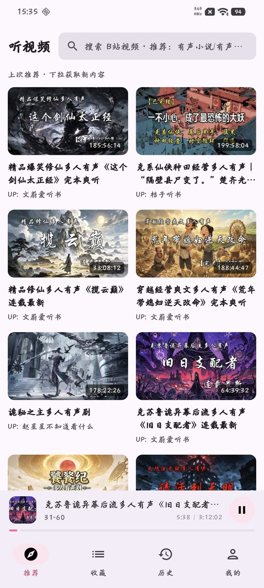
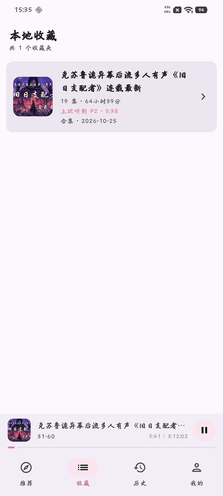
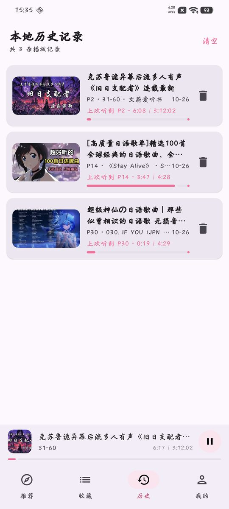

# 听视频 — 把某站当听书 App 用

👉 **下载 App：[点此前往 Releases 页下载最新版 apk](https://github.com/hpmdr/TingBili/releases/latest)**

> 某站上有海量的有声小说、多人有声剧、播客和公开课，可惜官方客户端是为「看视频」做的。
> 听视频只做一件事：**让你像用听书 / 播客 App 一样，听某站的声音**——熄屏、后台、断点续播、定时关闭。

## 为什么做这个

平时喜欢在某站听有声书，但用官方客户端「听视频」有几个难受的地方：

- **太重了**：同一台手机实测，打开「听视频」页面时内存占用 PSS 约 1.3GB、RSS 约 1.5GB，光图形渲染部分就占约 600MB。只是想睡前听个故事，手机却在发热耗电。
- **为看视频设计**：界面、推荐、交互全围绕画面来，熄屏听只是个附带功能。
- **长音频不好管**：几十上百小时的有声剧，听到哪了、下次接着听，都得自己记。

所以做了「听视频」：**不要视频画面，只要声音、字幕和进度**。同一台手机、同一时刻对比：听视频后台播放时 PSS 仅约 140MB，前台使用也在 200MB 上下，不到官方客户端的零头（机型、版本不同会有差异，欢迎自己验证：`adb shell dumpsys meminfo tv.danmaku.bili cn.debubu.tingbili`）。

轻，是因为我们压根不解码视频、不渲染弹幕、不预加载一堆和「听」无关的东西。

## 相比官方客户端的优势

听视频基于 **Android 原生技术栈**开发：Kotlin + Jetpack Compose + Media3，遵循 Material 3 设计规范，
是真正为安卓打造的原生应用，而不是套壳网页或跨平台框架。由此带来的直接好处：

- **原生 Compose UI**：界面由原生组件直接绘制，深色/浅色主题跟随系统，手机、平板、折叠屏自适应，交互流畅跟手。
- **真正的后台音频播放**：基于 Media3 + MediaSession 的音频引擎，熄屏、切 App、锁屏后继续播放，支持系统媒体通知、耳机线控与蓝牙控制；只拉音频流，不解码视频。
- **为「听」设计的交互**：AI 字幕跟读高亮、点字跳转、定时关闭、倍速、快进快退 30 秒、章节列表、断点续播，一切围绕听书场景。
- **轻巧省资源**：同一台手机实测，官方客户端「听视频」页面 PSS 约 1.3GB，听视频后台播放仅约 140MB、前台约 200MB，不到其零头（机型、版本不同会有差异）。
- **完全开源**：AGPLv3 协议，代码公开可审计，不夹带广告与无关功能。

## 截图看看

> 深色 / 浅色跟随系统，深浅两套都适配。下面先看最核心的**播放页**，再看其他页面（浅色）。

### 播放页

| 深色 | 浅色 |
|---|---|
|  |  |
| 字幕跟读、高亮，点一句跳一句 | 定时、倍速、快进快退、章节都在底下一排 |

### 其他页面

| 首页推荐 | 我的收藏 | 播放历史 |
|---|---|---|
|  |  |  |
| 听书推荐流，搜一下就有 | 自建歌单、合集一键成辑 | 每个节目都记住上次听到哪 |

## 下载安装

- 去 [Releases 页](https://github.com/hpmdr/TingBili/releases/latest)下载最新版 apk，手机浏览器打开直接安装（后续版本可覆盖更新）。
- 需要 Android 12 及以上。
- 想自己编译、改代码？看 [开发指南](docs/DEVELOPMENT.md)。

## 开发环境要求（自己编译前请先核对）

本项目坚持使用**最新稳定版**的工具链与依赖，环境版本偏旧会直接编译失败。克隆后请先检查：

| 项目 | 要求 | 检查命令 |
|---|---|---|
| JDK | **25**（Gradle toolchain 与字节码目标均为 Java 25） | `java -version` |
| Android SDK Platform | **android-37.2**（compileSdk 37.2） | `ls $ANDROID_HOME/platforms` |
| Android SDK Build-Tools | **36.0.0** | `ls $ANDROID_HOME/build-tools` |
| Android SDK Platform-Tools | 最新稳定版 | `adb version` |
| Gradle | **9.9.2**（wrapper 自动下载，无需手动装） | `cat gradle/wrapper/gradle-wrapper.properties` |
| Android SDK cmdline-tools | 1.1+ 的 `android` CLI（旧的 `sdkmanager` 已废弃） | `android --version` |
| 内存 | 建议 ≥ 16GB（全量构建 + 常驻 IDE / 浏览器时更宽裕） | `free -h` |

依赖与插件的精确版本统一在 [`gradle/libs.versions.toml`](gradle/libs.versions.toml) 维护，是唯一事实源。

环境不一致时：**先不要改代码或降级版本来将就**，把不一致项、本机实际版本和推荐版本一起报告给维护者，由维护者决定升级环境还是调整项目配置。完整步骤见 [开发指南](docs/DEVELOPMENT.md)。

## 常见问题

- **需要登陆吗？** 不需要登陆也能听，收藏和历史记录都是本地存储。
- **费流量吗？** 只拉音频流，比看视频省得多。

## 免责声明

- 本软件是第三方**非官方**客户端，与某站官方无任何隶属或授权关系；软件内资源均来自互联网，与作者本人无关，内容版权归原作者及平台所有，使用所产生的账号风险由使用者自行承担。
- 本软件以 **AGPLv3** 开源：你可以自由使用、修改和分发，但衍生作品也必须以 AGPLv3 开源。完整条款见 [LICENSE](./LICENSE)。
