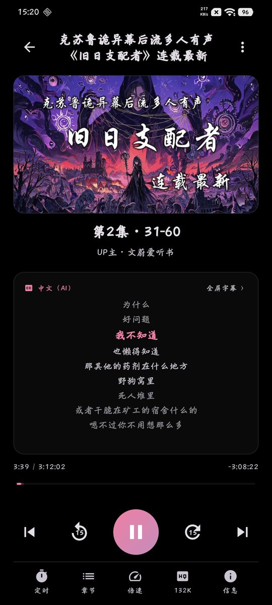
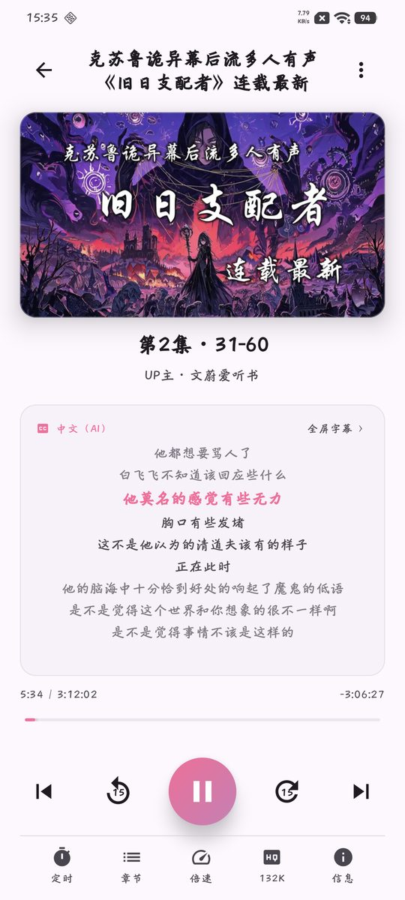
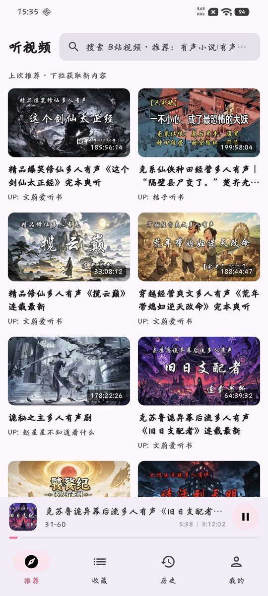
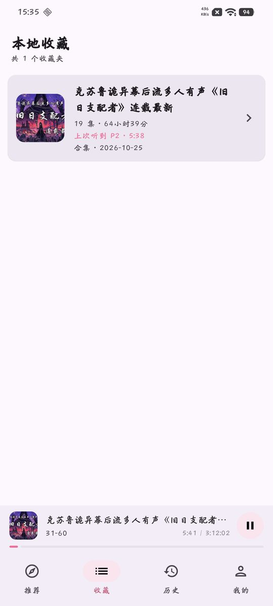
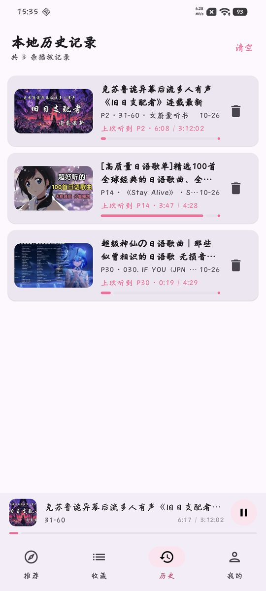

# 听视频 — 把某站当听书 App 用

👉 **下载 App：[点此前往 Releases 页下载最新版 apk](https://github.com/hpmdr/TingBili/releases/latest)**

> 某站上有海量的有声小说、多人有声剧、播客和公开课，可惜官方客户端是为「看视频」做的。
> 听视频只做一件事：**让你像用听书 / 播客 App 一样，听某站的声音**——熄屏、后台、断点续播、定时关闭。

## 为什么做这个

平时喜欢在某站听有声书，但用官方客户端「听视频」有几个难受的地方：

- **太重了**：同一台手机实测，打开「听视频」页面时内存占用 PSS 约 1.3GB、RSS 约 1.5GB，光图形渲染部分就占约 600MB。只是想睡前听个故事，手机却在发热耗电。
- **为看视频设计**：界面、推荐、交互全围绕画面来，熄屏听只是个附带功能。
- **长音频不好管**：几十上百小时的有声剧，听到哪了、下次接着听，都得自己记。

所以做了「听视频」：**不要视频画面，只要声音、字幕和进度**。同一台手机、同一时刻对比：听视频后台播放时 PSS 仅约 140MB，前台使用也在 200MB 上下，不到官方客户端的零头（机型、版本不同会有差异，欢迎自己验证：`adb shell dumpsys meminfo tv.danmaku.bili cn.debubu.tingbili`）。

轻，是因为我们压根不解码视频、不渲染弹幕、不预加载一堆和「听」无关的东西。

## 截图看看

> 深色 / 浅色跟随系统，深浅两套都适配。下面先看最核心的**播放页**，再看其他页面（浅色）。

### 播放页

| 深色 | 浅色 |
|---|---|
|  |  |
| 字幕跟读、高亮，点一句跳一句 | 定时、倍速、快进快退、章节都在底下一排 |

### 其他页面

| 首页推荐 | 我的收藏 | 播放历史 |
|---|---|---|
|  |  |  |
| 听书推荐流，搜一下就有 | 自建歌单、合集一键成辑 | 每个节目都记住上次听到哪 |

## 下载安装

- 去 [Releases 页](https://github.com/hpmdr/TingBili/releases/latest)下载最新版 apk，手机浏览器打开直接安装（后续版本可覆盖更新）。
- 需要 Android 12 及以上。
- 想自己编译、改代码？看 [开发指南](docs/DEVELOPMENT.md)。

## 常见问题

- **需要某站账号吗？** 不用也能搜、能听。扫码登录后可以同步你的收藏夹、稍后再看和历史。
- **要一直亮着屏吗？** 不用。熄屏、切后台、锁屏都能播，通知栏和锁屏可以直接暂停 / 切集。
- **费流量吗？** 只拉音频流，比看视频省得多；也支持 WiFi 下缓存好再听。
- **和官方客户端冲突吗？** 不冲突，可以同时装。两边历史互不影响，登录的是同一个某站账号而已。

## 免责声明

- 本软件仅供学习、测试与技术交流使用，请于下载后 24 小时内删除。
- 本软件所有资源均来自互联网，与作者本人无关；内容版权归原作者及平台所有。
- 本软件是第三方**非官方**客户端，与某站官方无任何隶属或授权关系；**禁止商用**，使用所产生的账号风险由使用者自行承担。
- 完整条款见 [LICENSE](./LICENSE)。
